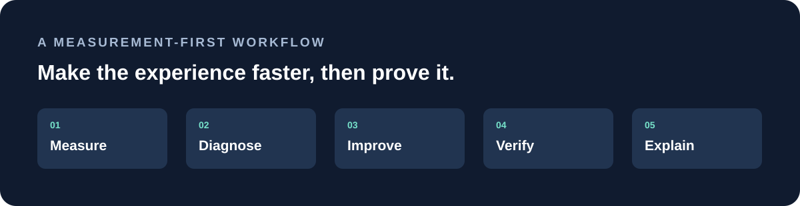

<div align="center">

# AliasOpti

### Make the website feel faster. Know why it is faster.

A portable performance skill for compatible AI agents, built around measurement, focused fixes and verification.

[Get started](#get-started) · [How it works](#how-it-works) · [Example output](#example-output) · [Troubleshooting](#troubleshooting)

</div>



## Why AliasOpti?

A page can have a good score and still feel slow. A checkout button may lag, a layout may jump while someone reads, or a page may load quickly only on a fast connection. Fixing those problems starts with understanding what real people experience.

AliasOpti gives your coding agent a repeatable way to investigate. It establishes a baseline, finds the likely causes, improves the biggest verified bottlenecks and checks that important features still work. It keeps the focus on evidence and user experience.

> **What it is:** a portable folder of instructions and reference material for a compatible AI coding agent.
> **What it needs:** access to the website project or an accessible URL. Browser tools, real-user data and backend access improve the investigation when available. Installing the skill does not install those tools or guarantee a score.

## How it works

| Stage | What the agent does |
| --- | --- |
| **Measure** | Identify important routes and interactions; record available field data and a repeatable lab baseline. |
| **Diagnose** | Inspect loading, responsiveness, layout shifts, network requests, assets and server behavior. |
| **Improve** | Rank measured problems by impact and risk; make focused fixes in the permitted scope. |
| **Verify** | Repeat comparable measurements and test key journeys, accessibility and regressions. |
| **Explain** | Share results, evidence, commands run, limitations and remaining work. |

The skill adapts to the tools and stack already present. It checks prerequisites and troubleshoots failures; it cannot promise to repair every environment or measure data it cannot access.

## What it investigates

- **Loading:** LCP element and its timing, oversized images, responsive formats, font loading, render-blocking resources and server response.
- **Responsiveness:** slow clicks, taps and keyboard interactions, long tasks, expensive rendering and JavaScript bundles.
- **Visual stability:** image dimensions, late content, fonts, embeds and layout shifts throughout the page lifecycle.
- **Network and backend:** duplicate requests, waterfalls, API latency, caching, CDN delivery and slow queries when access permits.
- **Real-world experience:** key journeys, mobile layouts, slower networks, cold and warm caches, and third-party costs.
- **Reliability:** builds, relevant tests, error handling, privacy, security and data freshness after changes.

### The metrics

| Core Web Vital | What it tells you | Good target |
| --- | --- | --- |
| **LCP** | How quickly the main content appears | ≤ 2.5 seconds |
| **INP** | How responsive interactions feel | ≤ 200 milliseconds |
| **CLS** | How stable the layout is | ≤ 0.1 |

These targets are assessed at the **75th percentile of real-user visits**, separately for mobile and desktop. Lab tests help diagnose problems; they do not replace field data. Lighthouse's Total Blocking Time is a diagnostic, not field INP. [About Core Web Vitals](https://web.dev/articles/vitals).

## Get started

### 1. Prerequisites

Install Git and a compatible coding agent. You need the path to your existing website project. The installer works with macOS, Linux and Git Bash on Windows. It installs only the skill files; browser, Lighthouse, application dependencies and data access are separate and optional according to your audit.

### 2. Download the repository

Run these commands in a location **outside** your website project. Use a folder name that does not already exist:

```sh
git clone https://github.com/akshatkotharii/aliasopti.git
cd aliasopti
```

You are now inside the AliasOpti repository. Keep your website in its own folder; this avoids nesting one Git repository inside another.

### 3. Install into your website project

From the AliasOpti repository, run **one** command. Replace the example path with the actual absolute path to your website project; keep the quotes if it contains spaces.

```sh
# Codex
./scripts/install.sh codex "/absolute/path/to/your-website"

# Claude Code
./scripts/install.sh claude "/absolute/path/to/your-website"

# GitHub Copilot in VS Code
./scripts/install.sh copilot "/absolute/path/to/your-website"

# Gemini CLI
./scripts/install.sh gemini "/absolute/path/to/your-website"

# Other compatible agents: pass their existing skills directory
./scripts/install.sh custom "/absolute/path/to/agent-skills-directory"
```

The script checks the source files, refuses to overwrite an existing installation, copies the entire skill and checks the copied files. It does not install software or modify your website's application code.

| Agent | Installed path inside your website project |
| --- | --- |
| Codex | `.agents/skills/aliasopti/` |
| Claude Code | `.claude/skills/aliasopti/` |
| GitHub Copilot in VS Code | `.github/skills/aliasopti/` |
| Gemini CLI | `.gemini/skills/aliasopti/` |
| Other skill-compatible agents | `aliasopti/` within the chosen skills directory |

Each destination contains `SKILL.md` and `references/` with both playbook and troubleshooting guides. Open **your website project**, not the AliasOpti checkout, in your agent. Refresh its skill list or start a new session if needed. Check [Codex](https://developers.openai.com/codex/skills/), [Claude Code](https://code.claude.com/docs/en/skills) or [VS Code](https://code.visualstudio.com/docs/agent-customization/agent-skills) for current discovery and personal-scope options. For Gemini CLI, see [its skills guide](https://geminicli.com/docs/cli/using-agent-skills/); use `/skills list` and `/skills reload` to verify discovery.

**Updating:** In your AliasOpti checkout, run `git pull --ff-only`. The installer intentionally refuses to overwrite an existing copy. Review and back up your existing skill folder, move it elsewhere, then run the installer again. This preserves any local changes and avoids stale files. Repeat for each project where it was installed.

**Manual installation:** Copy `skills/aliasopti` from this repository to the agent's skills directory shown above. Keep the folder structure intact; `SKILL.md` must be directly inside the installed `aliasopti` folder. Do not copy only the markdown file.

### 4. Ask for an audit

> Use AliasOpti to audit and improve this website. Focus on the homepage and checkout on mobile. Measure before changing anything, fix the biggest verified bottlenecks, and test the key flows.

Other useful requests:

- **Read-only:** “Use AliasOpti to investigate this site. Give me a prioritized report; do not change code.”
- **Specific issue:** “Use AliasOpti to investigate why the product page shifts while loading.”
- **Slow interaction:** “Use AliasOpti to trace the slow search interaction and verify any fix.”

### 5. Review the results

Look for the baseline, test conditions, evidence, changes, after measurements and functional checks. Ask the agent to explain missing measurements or unresolved failures. Field data may need time to accumulate after a deployment.

## Example output

The following is **illustrative only**, not a real audit or a claim of typical results.

```text
Route: /products · mobile lab · cold cache · 3 runs

Finding: Main image discovered late and larger than needed.
Evidence: Network waterfall and LCP trace.
Action: Serve a responsive image; make the LCP image discoverable early.
Verification: Compare repeated LCP measurements and check image quality.
Field INP: unavailable — no real-user data was provided.
Tests: product navigation and cart flow checked; build passed.
```

A real report should show actual measurements, the environment and any failures, instead of filling gaps with estimates.

## Tools and prerequisites

AliasOpti follows the portable Agent Skills folder format. Agents differ in discovery, permissions, available tools and skill support, so universal compatibility cannot be guaranteed. For an agent without skill support, give it `SKILL.md` and the referenced files as context; automatic discovery is unavailable. The skill itself has **no runtime dependencies**. Available diagnostics depend on the site and agent environment. Chrome DevTools can run Lighthouse without a separate CLI installation. For the optional Lighthouse CLI you need compatible Node.js and Chrome; follow [Chrome's installation guidance](https://developer.chrome.com/docs/lighthouse/overview/). Use the project's existing package manager, scripts and lockfile. Database analysis requires appropriate access and permissions. Do not send private URLs or credentials to public audit tools.

## Troubleshooting

| Problem | Check |
| --- | --- |
| Agent cannot find AliasOpti | Confirm the correct project directory, complete skill folder and agent-specific path; refresh the session. |
| `git clone` fails or folder exists | Check Git/network access; choose a fresh folder or update an existing clone with Git. |
| Website will not start | Follow the project's setup instructions, inspect runtime versions, required environment variables and port conflicts. Keep secrets private. |
| Lighthouse cannot run | Check Chrome availability and, for CLI use, compatible Node.js and Lighthouse. DevTools is an alternative. |
| Field data is unavailable | Record that limitation. Lab tests can still diagnose issues, but cannot establish real-user percentiles. |
| A fix breaks a test or makes performance worse | Inspect the failure, revise or revert the change, and repeat the affected checks. |

The agent has a fuller [error-recovery guide](skills/aliasopti/references/troubleshooting.md) for handling setup, measurement and verification failures.

## Repository structure

```text
aliasopti/
├── README.md
├── assets/workflow.svg
├── scripts/install.sh
└── skills/aliasopti/
    ├── SKILL.md
    └── references/
        ├── playbook.md
        └── troubleshooting.md
```

## Contributing

AliasOpti is intended to improve as we learn. Propose focused checks, clearer workflows or fixes backed by evidence and primary sources. Explain tradeoffs and avoid stack-specific assumptions. Open an issue or pull request with context and a reproducible example.
